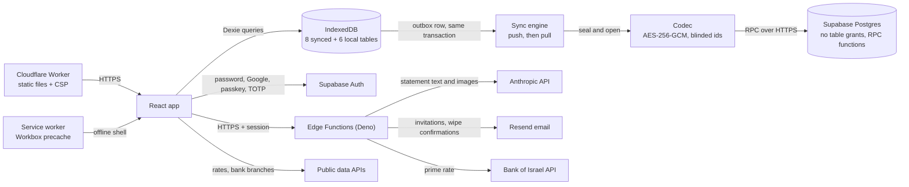

# Bookandry

A money manager for Israeli households that keeps a full copy of your data on every device, works offline, and syncs between your devices and a linked partner's account, in English and Hebrew.

[](https://github.com/Doofess/bookandry/actions/workflows/verify.yml)

<!-- SCREENSHOT: feed screen at 1440 px wide, Hebrew, light theme, demo data loaded, transaction side panel open. A second image at 390 px, English, dark theme. -->

## What it does

- Works offline with the same data on every device. Each device holds a full copy in IndexedDB, and changes sync through Postgres when the network returns.
- Scrolls years of transactions in one virtualised feed. With 4,000 transactions in a month, fewer than 80 rows are in the DOM.
- Runs fully in English or Hebrew, right to left. Amounts sit in a left-to-right island so Hebrew number formatting cannot move the minus sign.
- Models how people in Israel pay: instalments (תשלומים) that add up to the total exactly, credit (קרדיט) and loans on a Spitzer schedule, a card catalog of 5 card companies across 12 banks, and cash.
- Records any currency, with the exchange rate saved at entry and kept unless you change your base currency.
- Links up to ten accounts into one shared ledger by email invitation.
- Reads statements, spreadsheets and screenshots into transactions. Code reads known spreadsheet layouts, a model transcribes the rest, and the app checks the rows against the printed totals before you review them. Accuracy is not yet measured on real statements.

## How it works

Every screen renders from IndexedDB through Dexie. A Dexie middleware writes an outbox row in the same transaction as each change. The sync engine pushes the outbox, pulls pages from Postgres and merges by a revision string per row. Rows are sealed with AES-256-GCM before they leave the device. Clients have no access to the Postgres tables. Every read and write goes through SQL functions, and each one checks the caller, the account and the second sign-in factor itself. Edge Functions call Anthropic, send email and relay the Bank of Israel prime rate.



## Design decisions

- Local first, with the outbox in the same transaction as the data, so a write and its sync record cannot diverge. Push runs before pull, push is idempotent, and a pulled page commits with its cursor. The cost: last write wins per row, and every device downloads everything. [`convergence.test.ts`](src/db/sync/convergence.test.ts) checks that devices converge.
- Revisions that sort as text. `epoch-ms.counter.device` ([`rev.ts`](src/lib/rev.ts)) sorts the same in JavaScript, IndexedDB and Postgres, so no clock service is needed. Each push locks the account's row so sequence numbers follow commit order, which serialises pushes per account.
- New kinds of data go in new tables, never new enum values, because an older build rejects an unknown enum value forever but ignores an unknown table. The cost: the schema v4 upgrade made every device download everything once.
- The security boundary is the database. Every SQL function checks the second sign-in factor itself ([`second_step.sql`](supabase/migrations/20260930000000_second_step.sql)). Records are encrypted but not end to end: the encryption secret is stored unwrapped in the same database and linked accounts receive it, so a leaked records table is unreadable while the operator can read the data. An end-to-end passphrase design was built and removed after two days as too much to ask of a household.
- Three memo layers for the feed: query, series expansion and filtering depend on different inputs, so typing a search never touches IndexedDB. No Web Worker, since cloning about 600,000 occurrences costs more than computing them. [`scale.test.ts`](src/domain/scale.test.ts) runs 5,000 series over ten years.

The rest, including integer money and hand-written date maths, is in [docs/design-decisions.md](docs/design-decisions.md). How accounts, keys and linked accounts work, and the threat model, are in [docs/sync-and-security.md](docs/sync-and-security.md).

## Built with

| Layer      | Technology                                                                                       |
| ---------- | ------------------------------------------------------------------------------------------------ |
| App        | React 19, TypeScript, Vite, React Router                                                         |
| UI         | Tailwind CSS 4, Base UI, Recharts with d3-scale, TanStack Virtual                                |
| Local data | Dexie 4 over IndexedDB, zod                                                                      |
| Language   | i18next, English and Hebrew                                                                      |
| Offline    | vite-plugin-pwa (Workbox)                                                                        |
| Backend    | Supabase: Postgres with row-level security, Auth, Edge Functions on Deno                         |
| Services   | Anthropic models through Edge Functions, Resend for email                                        |
| Hosting    | Cloudflare Workers static assets                                                                 |
| Tests      | Vitest, Testing Library, fake-indexeddb, PGlite, fast-check, Playwright, axe-core, Lighthouse CI |

## Testing and quality

- 242 test files under `src/` with 3,018 `it(` and `test(` cases plus 99 `it.each` tables, counted by grep. 94 of the files are React component tests.
- 8 test files run the SQL migrations on Postgres in-process (PGlite): grants, row-level security, and two devices syncing through the codec.
- A fast-check property test runs 150 random histories of edits, deletes and syncs on two devices and checks that both devices and the server end identical.
- 25 Playwright spec files with 135 `test(` calls, in English, Hebrew and mobile projects. One kills the preview server and checks the app still shows its data; one seeds 4,000 rows under a 4x CPU throttle.
- axe checks 19 route, language and theme combinations against WCAG 2.2 AA; 11 fail on any violation, 8 report.
- Coverage thresholds: 100% for the money, date and recurrence modules, 60% overall (55% for branches).
- Custom gates ban physical-direction CSS classes, float maths on money, and card numbers in source.
- CI ([`verify.yml`](.github/workflows/verify.yml)) runs typecheck, ESLint with zero warnings, Prettier, the gates, Vitest with coverage and a production build on every pull request and push to `main`. Playwright and Lighthouse run locally through `pnpm verify:full`, not in CI.

## Try it

You need Node 26 (`.node-version` pins 26.8.2) and pnpm 12. Run the local-only build. It needs no account and no backend, and the setup wizard has a switch that loads demo data:

```bash
pnpm install
pnpm build:local
pnpm preview:local   # http://localhost:4173
```

The local-only build has no sign-in, sync, account linking or statement import; those need a Supabase project.

### Develop

```bash
pnpm install
pnpm dev            # http://localhost:5173
pnpm verify         # what CI runs
pnpm verify:full    # adds Playwright, Lighthouse, time zones and knip
```

For accounts and sync, set `VITE_SUPABASE_URL`, `VITE_SUPABASE_PUBLISHABLE_KEY` and `VITE_GOOGLE_CLIENT_ID` in `.env.local` and apply [`supabase/migrations`](supabase/migrations) to a Supabase project; see [docs/deploy.md](docs/deploy.md).

## Status

No active development since October 2026. Sharing files into the installed app works on Android only. Not built: bank connections (parked; a licence is needed), revolving credit, catalog fees for bank-issued cards (a card's fee can be typed in), CPI-linked loans and per-account balances. Known limitations are listed in [docs/known-limitations.md](docs/known-limitations.md).

## How it was built

Built with AI coding agents (Claude Code).

## License

MIT. See [LICENSE](LICENSE).
